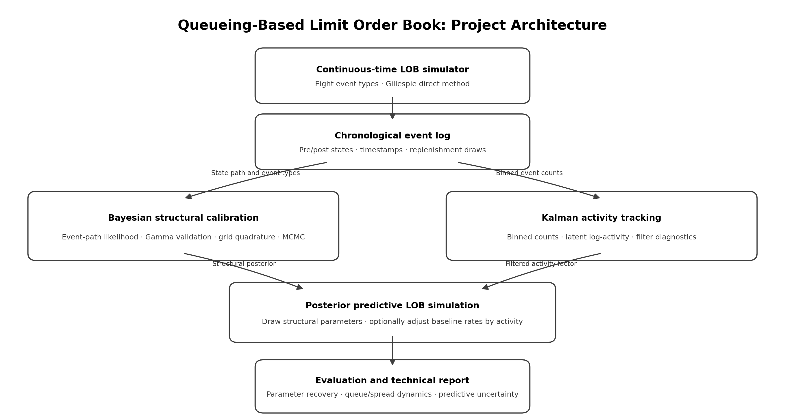
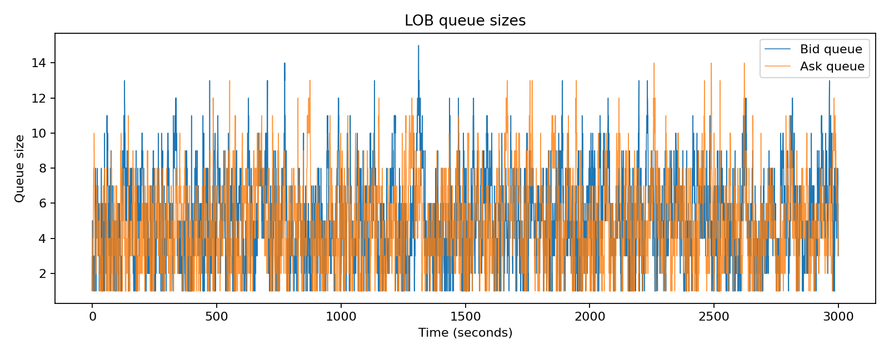
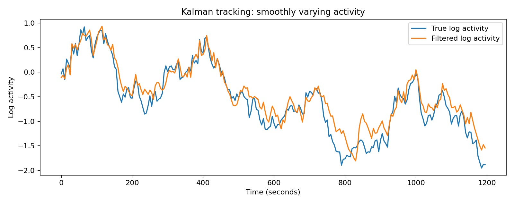
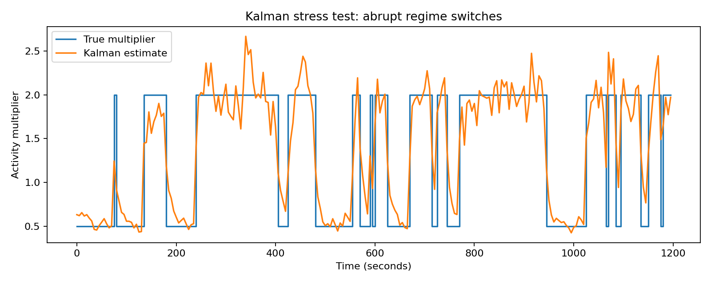
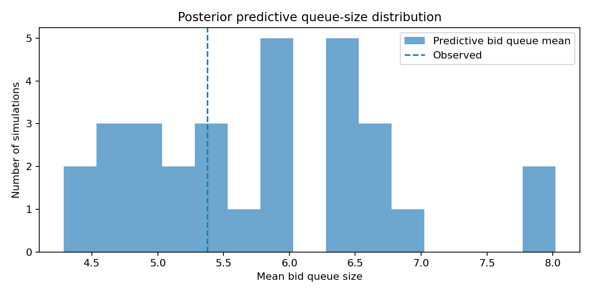

# Bayesian MCMC Calibration, Kalman Filtering, and Simulation of a Queueing-Based Limit Order Book

A reproducible Python research project for a simplified continuous-time limit order book (LOB). It combines queueing theory, continuous-time Markov event dynamics, Bayesian inference, Markov Chain Monte Carlo (MCMC), Kalman filtering, and posterior predictive simulation.

The complete mathematical and implementation requirements are recorded in [`SPEC.md`](SPEC.md). This README describes the implemented code and how to run it.

## 1. Project objectives

The project implements:

1. A continuous-time, event-driven LOB with eight event types.
2. Exact piecewise-constant evaluation of the event-intensity likelihood.
3. Gamma conjugate posterior calculations for suitable rate coefficients and the queue-replenishment parameter.
4. Two-dimensional grid quadrature and Metropolis-Hastings sampling for the queue-dependent limit-order parameters.
5. Posterior sampling for all ten structural log-intensity parameters under the specified Normal priors.
6. A scalar Kalman filter for a time-varying common market-activity factor inferred from binned event counts.
7. Smooth-activity and abrupt-regime stress experiments.
8. Posterior predictive LOB simulation and diagnostics.

The structural Bayesian model and the Kalman-filter activity experiment are distinct components. The filter multiplies all baseline event intensities by a common time-varying factor; it does not replace the ten-parameter structural model.

## 2. Visual overview

The diagram below summarizes the main implementation pipeline. The simulator produces the event path used by both the structural Bayesian calibration and the separate Kalman-filter activity experiment. Their outputs can then be used in posterior predictive simulations and evaluation.

<p align="center">
  
</p>

### Sample experiment outputs

The following figures are representative outputs from the experiment scripts. They are stored in `assets/` so that GitHub can render them directly in this README.

| Simulated queue dynamics | Smooth activity tracking |
|:---:|:---:|
|  |  |
| Bid and ask queue sizes evolve as events arrive and queues are depleted and replenished. | The filter tracks a smoothly varying latent log-activity factor from binned event counts. |

| Abrupt activity changes | Posterior predictive queue sizes |
|:---:|:---:|
|  |  |
| Stress test of the Gaussian filter when the true activity multiplier switches between regimes. | Distribution of mean bid queue sizes across posterior predictive simulations, with the observed reference shown. |

## 3. Model summary

The state is

\[
X_t=(Q_b,Q_a,P_b,P_a), \qquad Q_b,Q_a\geq 1,
\]

where the spread is \(S=P_a-P_b\geq 1\). Prices are measured in integer ticks.

The event intensity vector is ordered as follows:

| Event | Intensity | State effect |
|---|---|---|
| Buy limit at best bid | \(\exp(\theta_b+\gamma_b\log(1+Q_b))\) | \(Q_b\leftarrow Q_b+1\) |
| Sell limit at best ask | \(\exp(\theta_a+\gamma_a\log(1+Q_a))\) | \(Q_a\leftarrow Q_a+1\) |
| Market sell | \(\exp(\theta_{mb})\) | \(Q_b\leftarrow Q_b-1\) |
| Market buy | \(\exp(\theta_{ma})\) | \(Q_a\leftarrow Q_a-1\) |
| Cancel bid | \(\exp(\theta_{cb})Q_b\) | \(Q_b\leftarrow Q_b-1\) |
| Cancel ask | \(\exp(\theta_{ca})Q_a\) | \(Q_a\leftarrow Q_a-1\) |
| Buy limit inside spread | \(\exp(\theta_{ib})\mathbf 1[S\geq2]\) | \(P_b\leftarrow P_b+1, Q_b\leftarrow1\) |
| Sell limit inside spread | \(\exp(\theta_{ia})\mathbf 1[S\geq2]\) | \(P_a\leftarrow P_a-1, Q_a\leftarrow1\) |

When either queue is depleted, its best price moves outward by one tick and the new queue size is

\[
Q_{\mathrm{new}}=1+Y, \qquad Y\sim\operatorname{Poisson}(m).
\]

The simulator uses Gillespie's direct method. The next event waiting time is exponential with rate equal to the sum of all applicable event intensities.

## 4. Repository structure

```text
Queueing-Based-Limit-Order-Book/
├── README.md
├── SPEC.md
├── Makefile
├── requirements.txt
├── .gitignore
├── assets/
│   ├── project_architecture.png
│   ├── lob_queue_dynamics.png
│   ├── kalman_smooth_activity.png
│   ├── kalman_regime_stress.png
│   └── posterior_predictive_queue.png
├── configs/
│   └── default.yaml
├── src/
│   ├── __init__.py
│   ├── config.py
│   ├── diagnostics.py
│   ├── experiment_utils.py
│   ├── inference.py
│   ├── kalman_filter.py
│   ├── likelihood.py
│   ├── posterior_predictive.py
│   └── simulator.py
├── tests/
│   ├── test_simulator.py
│   ├── test_likelihood.py
│   ├── test_conjugate.py
│   ├── test_inference.py
│   └── test_kalman_filter.py
├── experiments/
│   ├── __init__.py
│   ├── experiment_1.py
│   ├── experiment_2.py
│   ├── experiment_3.py
│   ├── experiment_4.py
│   ├── experiment_5.py
│   └── experiment_6.py
├── data/
│   └── .gitkeep
├── results/
│   └── .gitkeep
└── notebooks/
    └── exploration.ipynb
```

## 5. Setup

Python 3.10 or later is recommended.

```bash
python -m venv .venv
```

Activate the environment:

```bash
# Linux / macOS
source .venv/bin/activate

# Windows PowerShell
.venv\Scripts\Activate.ps1
```

Install dependencies:

```bash
python -m pip install --upgrade pip
pip install -r requirements.txt
```

## 6. Run the tests

From the repository root:

```bash
python -m pytest -q
```

The tests cover intensity constraints, inside-spread gating, reproducible simulation, queue depletion invariants, likelihood exposure integration, Gamma posterior updates, MCMC output, grid normalization, and Kalman-filter behavior.

## 7. Run the experiments

Run each experiment from the repository root with `python -m`:

```bash
python -m experiments.experiment_1
python -m experiments.experiment_2
python -m experiments.experiment_3
python -m experiments.experiment_4
python -m experiments.experiment_5
python -m experiments.experiment_6
```

The experiments are:

| Script | Purpose | Main outputs |
|---|---|---|
| `experiment_1.py` | Simulator sanity check | Event log, queue plot, descriptive statistics |
| `experiment_2.py` | Full structural parameter recovery | Posterior summaries, trace plots, R-hat and ESS |
| `experiment_3.py` | Conjugate and grid-quadrature validation | Gamma posterior results and grid/MCMC comparison |
| `experiment_4.py` | Smooth activity tracking | True-vs-filtered activity path and RMSE |
| `experiment_5.py` | Abrupt activity stress test | Switching path, tracking error and regime classification diagnostic |
| `experiment_6.py` | Posterior predictive simulation | Replicated event logs and predictive summaries |

Generated event logs are written to `data/`; tables, plots, and JSON summaries are written to `results/`.

## 8. Configuration

Change simulation and experiment settings in [`configs/default.yaml`](configs/default.yaml). The configuration contains:

- Structural parameters and initial LOB state.
- Queue-replenishment parameter \(m\).
- Simulation horizons and random seed.
- Gamma prior hyperparameters.
- MCMC samples, burn-in, and number of chains.
- Grid-quadrature resolution.
- Kalman-filter bin width, persistence, and process-noise variance.
- Posterior-predictive simulation count.

Random seeds, the model configuration, and experiment code should be retained with any reported results.

## 9. Statistical implementation notes

### Continuous-time likelihood

For event \(k\) of type \(e_k\), the state is evaluated immediately before the event. The log-likelihood is

\[
\ell(\Theta)=\sum_k\log\lambda_{e_k}(X_{t_k^-};\Theta)
-\int_0^T\sum_e\lambda_e(X_t;\Theta)\,dt.
\]

Because the state is piecewise constant between events, the compensator integral is evaluated as a sum of interval lengths multiplied by the total intensity in each interval. The replenishment draws are conditioned upon and excluded from this event-intensity likelihood.

### Conjugate validation

For \(\lambda_e(X_t)=r_eg_e(X_t)\), with \(r_e\sim\operatorname{Gamma}(\alpha_e,\beta_e)\) in shape-rate form,

\[
r_e\mid\mathcal D\sim\operatorname{Gamma}\left(
\alpha_e+n_e,\beta_e+\int_0^Tg_e(X_t)\,dt\right).
\]

For replenishment, \(Y_i=Q_{\mathrm{new},i}-1\sim\operatorname{Poisson}(m)\), giving

\[
m\mid\{Y_i\}\sim\operatorname{Gamma}\left(
\alpha_m+\sum_iY_i,\beta_m+n\right).
\]

### Non-conjugate inference

The pairs \((\theta_b,\gamma_b)\) and \((\theta_a,\gamma_a)\) are sampled jointly by random-walk Metropolis-Hastings. A two-dimensional grid posterior is computed as an independent benchmark. The six scalar log-rate parameters are sampled with one-dimensional Metropolis-Hastings under the specified Normal log-parameter priors. Gamma calculations are retained as a separate conjugate validation parameterization.

### Kalman approximation

The activity state follows

\[
h_k=\rho h_{k-1}+w_k,\quad w_k\sim\mathcal N(0,q).
\]

For each time bin, the implementation calculates baseline integrated intensity \(A_k\), count \(N_k\), and transformed observation

\[
z_k=\log\left(\frac{N_k+0.5}{A_k}\right),\qquad
R_k\approx\frac{1}{N_k+0.5}.
\]

This is a delta-method Gaussian approximation to the Poisson count observation, not an exact linear-Gaussian representation. Zero or invalid baseline exposure is treated as a missing observation, which causes a prediction-only Kalman step.

## 10. Event-log format

The core fields are retained in the order required by the specification:

```text
t, event, Qb_before, Qa_before, Pb_before, Pa_before, session,
Qb_after, Qa_after, Pb_after, Pa_after
```

The implementation adds `Qb_replenished` and `Qa_replenished` to record replenishment draws. A non-missing value indicates that the corresponding queue was depleted and replenished during that event.

## 11. Scope and limitations

This is a simplified statistical market model, not a production exchange simulator or trading system. It does not include multiple levels of depth, hidden liquidity, iceberg orders, strategic agent behavior, or exchange-specific matching rules. The Kalman filter tracks broad activity changes from aggregated counts and may lag abrupt changes or perform poorly when bins contain few events.

## 12. Reproducibility

- Set random seeds in configuration and experiment scripts.
- Preserve `configs/default.yaml` alongside generated results.
- Avoid committing large generated event logs unless they are intended as compact examples.
- Record package versions when preparing final research results.
- Re-run `pytest -q` before accepting changes to simulator, likelihood, inference, or filtering code.

## 13. Expected research deliverables

The experiments should produce the quantitative evidence needed for the final report: parameter estimation error and credible-interval coverage, posterior diagnostics, grid/MCMC agreement, queue and spread statistics, activity-tracking RMSE and lag, stress-test diagnostics, posterior predictive discrepancies, and computational runtime.
